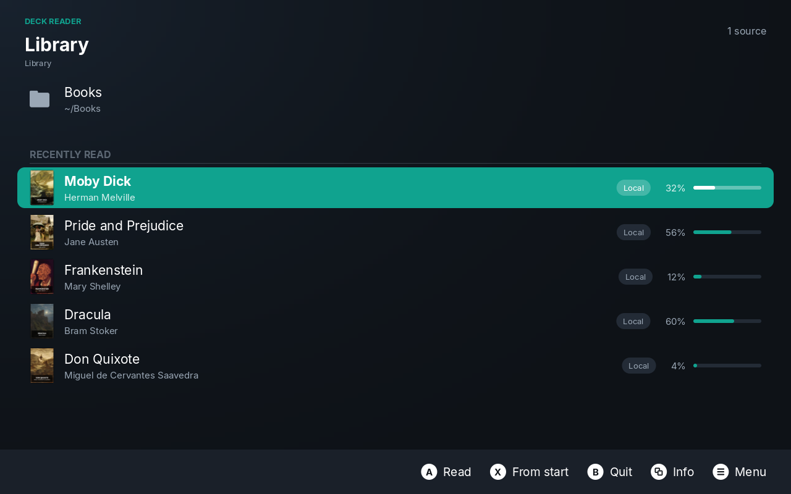
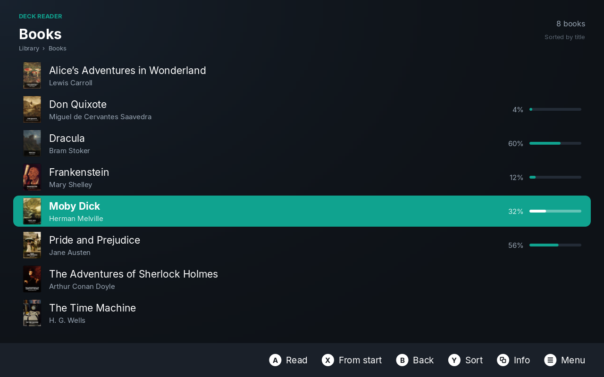
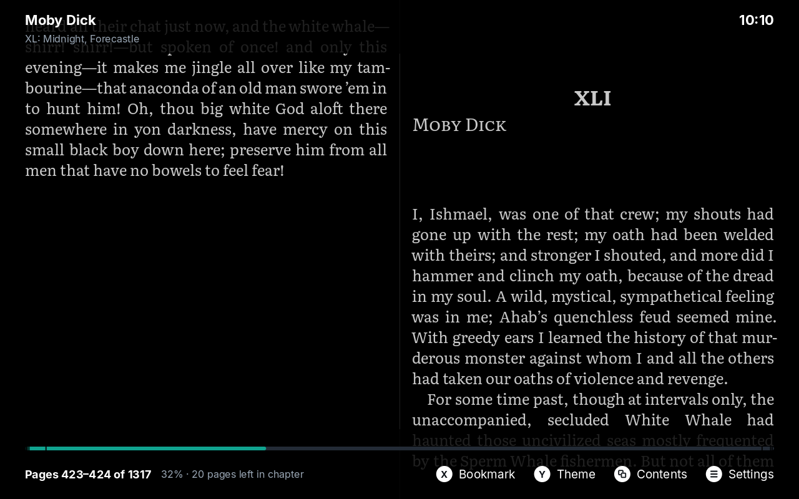
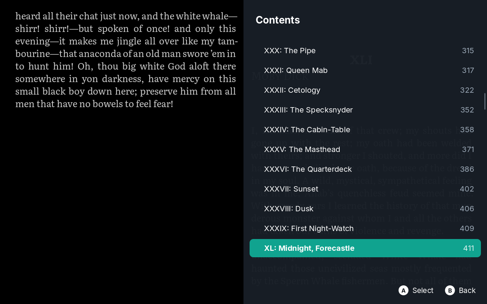
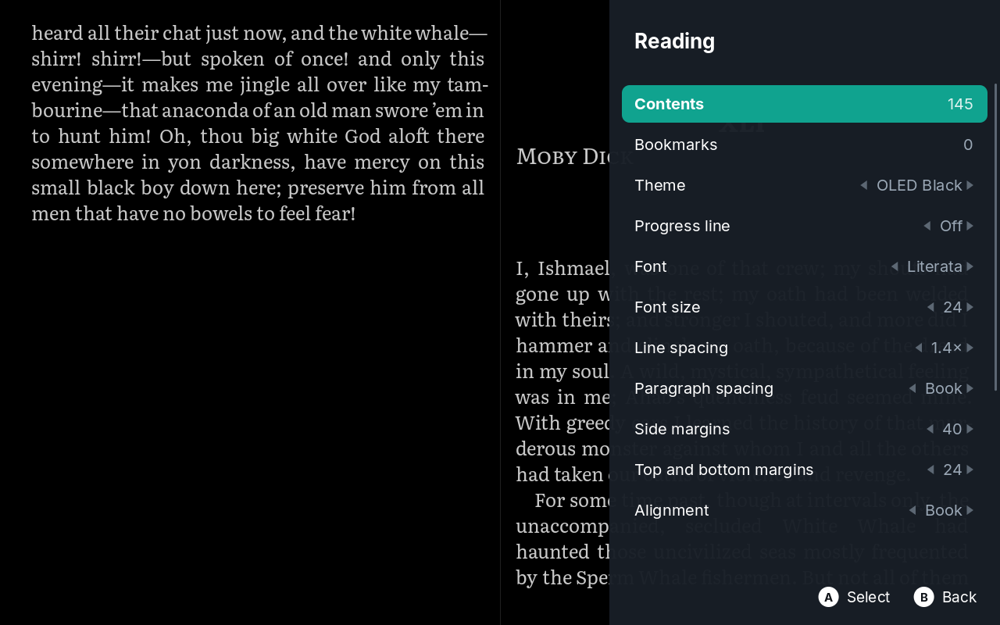
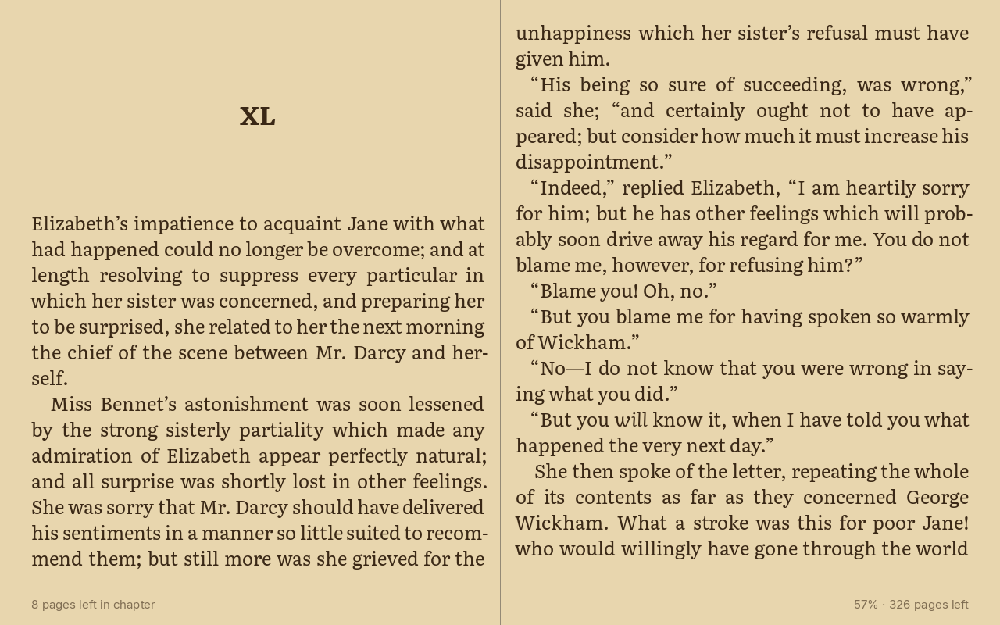
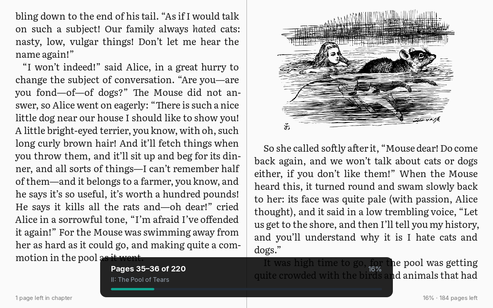

# DeckReader

**An EPUB e-book reader for the Steam Deck and SteamOS Game Mode.** Read
your own ebooks with the controller, straight from the Steam library,
without switching to Desktop Mode: books from your folders, the microSD
card and USB drives, set like a printed book (hyphenation, justified
text, two pages side by side on the Deck's wide screen), with true-black
themes for the Steam Deck OLED. Your place is saved on every page turn.

It is a free, open-source and lightweight app built on the
[crengine-ng](https://gitlab.com/coolreader-ng/crengine-ng) book engine
(the continuation of CoolReader's engine) and SDL3. It installs as a Flatpak with a Steam
shortcut (a *Non-Steam game* with library artwork), and works offline:
the network is used only to download your web articles from
[wallabag](https://wallabag.org), if you connect it. It is the companion of
[Deck Video Player](https://github.com/nicocarbone/DeckVideoPlayer): same
look, same buttons, same installer.

> [!WARNING]
> **Beta software.** DeckReader 0.1 is a first version. The developer has
> tried it in Game Mode on a **Steam Deck OLED**; the Steam Deck LCD, other
> handhelds and desktop Linux are untested. Expect bugs, and please
> [report them](https://github.com/nicocarbone/DeckReader/issues). The
> installer edits Steam's `shortcuts.vdf` (it keeps a `.bak` copy).
> Provided **without any warranty**, as described in the GPL (`LICENSE`).


## Features

- **EPUB 2 and EPUB 3** books without DRM, with real book typography:
  hyphenation in the book's language, justification, small caps,
  illustrations, and the book's own styles and fonts (both optional).
- **Two pages side by side** on the 1280×800 screen, or one page. Text
  size, line and paragraph spacing, margins and alignment.
- **Four themes**, switched instantly with Y: OLED Black (true black,
  pixels off), OLED Dark (no black smear on page turns), Sepia and Day.
  Black line art stays visible on the dark themes.
- **Three bundled fonts**: Literata (made for ebooks), Inter and Atkinson
  Hyperlegible (for low vision), or the book's own fonts.
- **Library** from `~/Books` and any other folder, microSD cards and USB
  drives: covers, titles and authors, reading progress, sorting by title,
  author, last read or newest, and your **recently read** books on the
  start screen, so A resumes the last one. Mark any book or article as
  read (✓) or unread (back to 0%) from the menu.
- **Web articles from wallabag**: save articles on your phone with
  wallabag (the hosted wallabag.it or your own server) and read them on
  the Deck, pictures and math included, from an **Articles** shelf. Mark
  one as read and it's archived in wallabag too.
- **Contents, bookmarks, chapter jumps** with the D-pad, and a
  **left-stick scrub** through the whole book with a live preview.
- **Status overlay** with chapter, pages, percentage, battery and clock
  (Steam's top bar is hidden in Game Mode), and an optional **progress
  line** under the text: pages left in the chapter and in the book.
- **Your place is saved on every page turn**, safe against sleep, a dead
  battery or closing the app from Steam.
- **The screen stays on while you read**: no dimming or sleep in the
  middle of a page. After 10 minutes without a button press, SteamOS's
  own dim and sleep timers apply again.
- **Touchscreen**: tap the edges or swipe to turn pages, tap the middle
  for the overlay.
- **Easy on the battery**: nothing runs while you read, and the next
  pages are ready before you turn.
- **Scales to 4K TVs** for a docked Deck or a Steam Machine.
- **Private**: no account, no tracking. The network is used only for
  wallabag, when you update your articles (and their pictures) or mark one
  as read.

## Screenshots

| | |
|---|---|
|  |  |
| Start screen: folders, then your recently read books | Library with covers and progress |
|  |  |
| Status overlay (A) | Contents (View button) |
|  |  |
| Reading settings (Menu button) | Sepia theme and the progress line |
|  |  |
| Day theme with illustrations | Left-stick scrub |

Taken at the Steam Deck's 1280×800 resolution with the development build,
headless (`tools/make-screenshots.sh`). The books are public-domain
editions from [Standard Ebooks](https://standardebooks.org), whose work is
dedicated to the public domain (CC0): *Moby Dick*, *Pride and Prejudice*,
*Alice's Adventures in Wonderland* with John Tenniel's illustrations, and
others.

## Why another e-book reader for the Steam Deck?

The Deck's screen is a good size for reading, and good readers already run
on Linux. The gap is **Game Mode**: reading your own books from the couch
or in bed with the controller, without the Desktop Mode detour. When this
project started (November 2026) we found nothing made for that. Here is
what exists; corrections are welcome.

- **[KOReader](https://koreader.rocks)** ([Flathub][koreader-flathub]) is
  the most capable open-source reader: many formats (EPUB, PDF, DjVu,
  comics, FB2, MOBI…), dictionaries, highlights, statistics and sync. Its
  interface is made for e-ink touch devices, and its Linux build has had
  preliminary gamepad support (buttons sent as keys) since 2018
  ([wiki][koreader-gamepad]). **If you need PDFs, comics or its many
  features, KOReader is the better choice.**
- **[Readest][readest] and [Foliate][foliate]** are modern desktop readers
  on Flathub, made for mouse, keyboard and touch. They work well in
  Desktop Mode; in Game Mode the controller has to be mapped to keys with
  Steam Input.
- **[Bookshelf][bookshelf]** is a reader sold on Steam (EPUB and PDF, lists
  SteamOS + Linux), so it starts from the Steam library; its store page
  doesn't say whether it supports controllers.
- **Calibre's e-book viewer** is a desktop app as well.

What DeckReader adds is deliberately narrow: a reader built for Game Mode
first, where every screen works with the controller, with typography and
themes chosen for the Deck's screen, your place saved on every page turn,
and a Steam shortcut with artwork. It is **not** a library manager like
Calibre, and it reads only DRM-free EPUB files for now.

[koreader-flathub]: https://flathub.org/apps/rocks.koreader.KOReader
[koreader-gamepad]: https://github.com/koreader/koreader/wiki/Gamepad-support
[readest]: https://flathub.org/apps/com.bilingify.readest
[foliate]: https://flathub.org/apps/com.github.johnfactotum.Foliate
[bookshelf]: https://store.steampowered.com/app/1458680/

## Install on Steam Deck and SteamOS

Not on Flathub yet: install from the
[GitHub releases](https://github.com/nicocarbone/DeckReader/releases).

1. Switch to **Desktop Mode**, download the release archive
   (`DeckReader-vX.Y.Z.tar.gz`) and extract it.
2. Open Konsole in the extracted folder and run:

   ```sh
   ./scripts/install-steamos.sh
   ```

   This installs everything for your user only (nothing on SteamOS's
   read-only system partition, so it survives SteamOS updates):
   - the app's Flatpak (and the Freedesktop runtime from Flathub),
   - a `~/Books` folder,
   - a **Non-Steam game** shortcut with library artwork.

3. Copy your `.epub` files into `~/Books`, or onto the microSD card or a
   USB drive (they are listed automatically).
4. Return to **Gaming Mode** and start *DeckReader* from the library.

Uninstall with `./scripts/install-steamos.sh --uninstall` (your settings
and reading positions are kept).

## Controls

| Button | Library | Reading |
|---|---|---|
| **A** | Open / read | Show or hide the status overlay |
| **B** | Back (quit at the start screen) | Hide the overlay, else back to the library |
| **X** | Read from the beginning | Bookmark this page (again to remove) |
| **Y** | Sort by title, author, last read or newest; on Articles: update them | Next theme |
| **D-pad ← →**, **L1 / R1** | Page through the list | Previous / next page |
| **D-pad ↑ ↓** | Move | Previous / next chapter |
| **L2 / R2** | First / last item | Previous / next chapter |
| **View** | Book info | Contents |
| **Menu** | Library menu (update articles, mark as read or unread, mark as read in wallabag, refresh, remove from recently read, about, quit) | Reading settings, bookmarks, mark as read in wallabag, about |
| **Left stick** | Move | Hold left or right to scrub through the book |
| **Touchscreen** | Tap a row | Tap the edges or swipe: page; tap the middle: overlay |

The same buttons do the same things in Deck Video Player. A keyboard also
works (arrows, Enter, Esc/Backspace, `x`, `y`, `m`, `i`, PgUp/PgDn,
Home/End, Ctrl+Q to quit).

## Settings

Reading settings are in the reader's **Menu**: theme, progress line, font,
font size, line and paragraph spacing, side and top/bottom margins,
alignment, one or two pages, hyphenation, the book's own styles and text
rendering. They apply to every book and are kept between sessions.

Book folders, your wallabag account and a few other options (the
recently read list, the clock format, interface size, accent colour, tap
zones, keeping the screen awake) are in
`~/.config/deckreader/config.ini`, created on the first start; see
[docs/CONFIGURATION.md](docs/CONFIGURATION.md). The Flatpak can read
`~/Books`, Documents, Downloads, `/mnt` and removable drives; for another
folder:

```sh
flatpak override --user --filesystem=/path/to/books:ro io.github.nicocarbone.DeckReader
```

## How it works

```
Steam (Game Mode) ─ launches ─▶ flatpak run io.github.nicocarbone.DeckReader
                                   │  one process, one thread, sleeps until input
                                   ├─ crengine-ng: EPUB → pages (hyphenation, CSS, fonts)
                                   ├─ SDL3: window, GPU textures, gamepad, touch
                                   ├─ FreeType + HarfBuzz: the interface's text
                                   ├─ while reading: a small helper asks Steam
                                   │  not to dim the screen (D-Bus)
                                   └─ when you update articles: a background
                                      thread downloads them from wallabag (HTTPS)
                                   ▼
                              gamescope ─▶ Steam Deck screen / TV
```

- Each screen of the book is drawn once into a texture; the next and
  previous screens are prepared in the background, so a page turn only
  shows a texture that is already there.
- Positions are stored as places in the text, not page numbers, so they
  survive font and size changes. Saving writes a new file and renames it
  over the old one: a sudden power loss leaves the previous version, never
  a broken one.
- Books are untrusted input: archives are checked before opening, and the
  engine is patched so the sizes checked are the sizes read.

More in [docs/ARCHITECTURE.md](docs/ARCHITECTURE.md).

## Documentation

| Document | Contents |
|---|---|
| [docs/CONFIGURATION.md](docs/CONFIGURATION.md) | Every `config.ini` setting |
| [docs/ARCHITECTURE.md](docs/ARCHITECTURE.md) | How it works: modules, main loop, drawing, book engine, files |
| [docs/DECISIONS.md](docs/DECISIONS.md) | Decision log with alternatives and reasons |
| [docs/DEVELOPMENT.md](docs/DEVELOPMENT.md) | Building, testing (unit, headless, Flatpak, on a Deck), releasing |
| [REQUIREMENTS.md](REQUIREMENTS.md) | What the app must do |
| [CHANGELOG.md](CHANGELOG.md) | What changed in each release |
| [docs/ROADMAP.md](docs/ROADMAP.md) | What comes next |
| [AGENTS.md](AGENTS.md) | Quick orientation for AI agents and new contributors |
| [THIRD_PARTY_NOTICES.md](THIRD_PARTY_NOTICES.md) | Licences of the bundled components |

## Building

Everything builds inside the Freedesktop SDK, so nothing needs installing
on the host besides it (`flatpak install --user flathub
org.freedesktop.Sdk//26.08`):

```sh
scripts/dev-build.sh                  # development build in .dev/
scripts/dev-run.sh                    # run it in a window
tests/run.sh                          # all tests
tools/headless-run.sh -- "idle; shot:/tmp/lib.png; quit"   # screenshot, no display
scripts/build-flatpak.sh --install    # dist/DeckReader.flatpak
```

Details in [docs/DEVELOPMENT.md](docs/DEVELOPMENT.md).

## Roadmap

Next: footnotes in a popup, fallback fonts for Chinese, Japanese, Korean,
Arabic and Hebrew, and the other formats the engine already reads (FB2,
MOBI without DRM, TXT). Then newsletters and blogs by feed (Substack,
Ghost, any RSS or Atom feed), and OPDS catalogues (Calibre-web, Kavita,
Komga) to download books from your own server. See
[docs/ROADMAP.md](docs/ROADMAP.md).

## Questions

- **How do I read ebooks on the Steam Deck in Game Mode?** Install
  DeckReader (above), copy EPUB files into `~/Books` or onto the microSD
  card, and start DeckReader from the Steam library.
- **Where can I get free ebooks?** [Standard Ebooks](https://standardebooks.org)
  makes carefully produced public-domain classics, and
  [Project Gutenberg](https://www.gutenberg.org) has over 75,000. Both
  offer EPUB downloads.
- **Can it open Kindle, Kobo or Google Play books?** Only DRM-free EPUB
  files. Books bought in most stores are protected (DRM) and DeckReader
  can't open them. Kindle books are not EPUB files.
- **What about PDF, MOBI, FB2 or comics?** EPUB only for now. FB2, MOBI
  without DRM and TXT are planned; for PDFs and comics use KOReader.
- **Do I need Desktop Mode?** Once, to run the installer. Books can then
  come on a microSD card or USB drive, which DeckReader lists on its own.
- **Is my place kept if the Deck sleeps or the battery dies?** Yes. The
  position is saved on every page turn (at most every two seconds while
  you flip through pages), when the Steam overlay opens and when the app
  closes.
- **Can I read web articles?** Yes, with [wallabag](https://wallabag.org),
  a read-it-later service: use the hosted
  [wallabag.it](https://wallabag.it) (paid, with a free trial) or run it
  on your own server. Save articles from your phone's share menu or a browser
  add-on, add your account to the `[wallabag]` section of `config.ini`
  ([docs/CONFIGURATION.md](docs/CONFIGURATION.md)), then press Y on
  **Articles**. They stay readable offline.
- **Does the screen dim while I read?** No. While a book is open,
  DeckReader asks SteamOS not to dim the screen or sleep, until 10 minutes
  pass without a button press (`keep_awake_minutes` in `config.ini`). In
  the library, SteamOS's own settings apply. *About* (in the Menu) shows
  whether SteamOS accepted.
- **Does it work on the Steam Deck LCD, other handhelds or desktop
  Linux?** Not tested yet. The LCD model has the same resolution and
  should work; anything running SteamOS's Game Mode (gamescope) may work.
  Reports are welcome.

## Known limitations

- Tested by the developer on a Steam Deck OLED only; the full on-device
  checklist ([docs/DEVELOPMENT.md](docs/DEVELOPMENT.md) §7) and battery
  measurements are still open.
- Links and footnotes can't be followed yet.
- Chinese, Japanese, Korean, Arabic and Hebrew text needs fonts that are
  not bundled yet.
- Changing the font or text size lays out the whole book again: on a very
  long book this takes a moment (a pill says "Updating pages…").

## Support the project

DeckReader is free and will stay free. If it is useful to you and you'd
like to say thanks:

Ko-fi takes quick one-off tips by card or PayPal, no account needed:
**[ko-fi.com/nicocarbone](https://ko-fi.com/nicocarbone)**.

Bug reports and testing on other devices help just as much.

## License

© 2026 nicocarbone. Licensed under the **GNU General Public License v2.0
or later** (`LICENSE`), like Deck Video Player. The book engine is
[crengine-ng](https://gitlab.com/coolreader-ng/crengine-ng)
(GPL-2.0-or-later), with small patches in `patches/`; the bundled fonts
are under the SIL Open Font License. Every release includes the complete
corresponding source of the bundle (`DeckReader-<version>-sources.tar.gz`).
Every component and its licence:
[THIRD_PARTY_NOTICES.md](THIRD_PARTY_NOTICES.md).

Steam, Steam Deck and SteamOS are trademarks of Valve Corporation. This
project is not affiliated with or endorsed by Valve.
